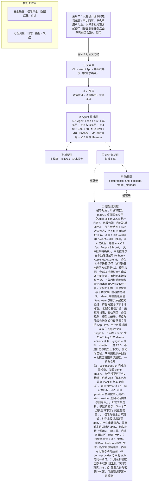

# PRD 推导方案 ——「端侧AIStudio」

> 状态：方案待确认（Step 1–4 已完成，Step 5 代码生成需确认后启动）
> 推导引擎：Agent Blueprint · 模型：anthropic

## 产品定位（一句话）

**端侧AIStudio**：给没有设计团队的电商运营与中小商家，在端侧 AI 主机上用全本地推理把「生成一张图」变成可批量、可复用、可交付的电商素材生产线，商品素材全程不离开设备。

## ⚠️ 待确认清单（答不上就是风险点）

1. 账号/授权/算力调度具体对接哪个 OS 能力或哪家平台，还是纯假设？一期不自建平台的可插拔接口按什么契约定义？
2. 团队与时间约束未定：是否按「2–3 人、8 周出 MVP」收口 V1 范围？确认后哪些 FR 需要移出 V1？
3. 首轮采纳率、初稿到定稿耗时、批次一致性分、导出一次通过率的目标值均为「待实测」，MVP 的基线采集方式、样本量与采样周期是什么？
4. 在 Apple Silicon 32GB 上跑 FLUX.1-dev / Qwen-Image 的峰值内存、OOM 率与终稿单图耗时是否已实测？若 p95 ≤ 2min 达不到，延迟包络如何重定？
5. 失败降级链的触发阈值与判据是什么（何时换小模型、何时降分辨率、何时转非生成式管线），降级后如何向用户呈现并留痕？
6. 5 平台（淘宝/天猫/京东/拼多多/抖音）的渠道规格表初始数据来源与维护责任人是谁？规格变更由谁更新？
7. 单机并发上限是多少（同时可提交多少个 SKU 批次、队列上限与配额策略）？超限时如何提示？
8. 撤销历史与资产库的保留与清理策略（磁盘配额、自动清理、归档保留期）未定，长期使用磁盘占满时如何处理？
9. 目标用户的使用频率（每天/每周几个 SKU）未说明，如何据此设定默认批量规模与草稿张数？
10. 批次一致性分（DINO 相似度均值）、首轮采纳率（首批 4 张中直接选用或仅微调即选用的比例）、导出一次通过率（导出后无需返工的比例）的计算口径已由 PRD 第 5 节给定；仍未确定的是采样方式（全量统计还是抽样）与基线数值，需首次实测后回填。
11. 画布前端具体框架（Swift/SwiftUI 为推断）与 Python 推理管线之间的进程边界和通信方式（XPC 或子进程加本地 socket）未在输入中说明。
12. 模型文件存放目录、下载校验流程与热切换归属哪个组件未在输入中说明。
13. 撤销历史与项目图自动保存的保留深度、是否跨重启保留未在输入中说明。
14. 账号、授权、配额一期为可插拔对接，其数据访问范围与敏感数据处理规则未在输入中说明。
15. 副场景 3–10 人小团队是否会共用同一台设备、是否需要多用户隔离，未在输入中说明。
16. 一条命令启动的具体脚本形态、构建方式与最低 macOS 版本未在输入中说明。

## Step 1 · 需求拆解（提取硬事实）

| 维度 | 结论 | 状态 | 出处 |
|---|---|---|---|
| 目标 | 把「生成一张图」变成「可批量、可复用、可交付的生产线」；可量化成功标准为北极星指标：首轮采纳率（每 SKU 首批默认 4 张中直接选用或仅微调即选用的比例，MVP 先采基线，待实测）、初稿到定稿耗时（单 SKU × 5 平台 p95 ≤ 30min，待实测）；过程指标含批次一致性分 ≥ 0.85、导出一次通过率 ≥ 90%、任务恢复率 100%（均待实测）。 | 明确 | 「一句话：把“生成一张图”变成“可批量、可复用、可交付的生产线”」；第 5 节「首轮采纳率（北极星）…初稿到定稿耗时（北极星）…单 SKU × 5 平台 p95 ≤ 30min（待实测）」 |
| 用户 | 主用户：没有设计团队的电商运营 / 中小商家，单机单用户为主，以异步批处理方式使用（提交批量任务后由队列在后台跑）。副用户（二期）：3–10 人短剧小团队。使用频率与是否多用户共用同一台设备未说明。 | 明确 | 「主场景：电商素材。用户：没有设计团队的电商运营/中小商家」；「副场景：短剧分镜。用户：3–10 人小团队」；第 2 节「单机单用户为主，异步批处理」 |
| 核心闭环 | 电商主闭环：新建 SKU → 上传 3–5 张实拍 → 自动抠图/质检 → 生成一致性锚点 → 选渠道模板 → 批量草稿 → 选优/局部重绘 → 终稿 → 后处理/导出 → 归档复用。全程读写同一张项目图（DAG），改一个节点只重算下游。 | 明确 | 「电商：新建 SKU → 上传 3–5 张实拍 → 自动抠图/质检 → 生成锚点 → 选渠道模板 → 批量草稿 → 选优/局部重绘 → 终稿 → 后处理/导出 → 归档复用。」 |
| 交付物 | 按 5 个电商渠道规格裁切、命名、打包的电商素材包（裁切/文字/水印/格式/打包，导出前需用户确认），以及可复用的项目图（DAG）+ 内容寻址资产库，用于后续 SKU 归档复用。 | 明确 | 「交付物 ／ 按渠道规格裁切/命名/打包的电商素材包 + 可复用的项目图（DAG + 内容寻址资产库）」；FR6「裁切、文字、水印、命名、格式、打包；导出前需用户确认」 |
| 边界 | 红线：用户上传的商品图/参考图/生成物默认永不离开设备，除用户显式勾选外不触发任何上传（模型下载属设备主动拉取，不算上传）；全部推理本地完成、无云端兜底（demo 可用 API 验证链路，但产品方案必须写本地推理）；不静默失败，降级必须可见并说明。非目标：不做通用聊天助手、云端设计平台、云端协作、专业剪辑、模型训练平台；短剧不做长片/配音/配乐（二期也不做）。 | 明确 | 第 4 节边界与红线；「非目标：不做通用聊天；不做云端协作；不做专业剪辑；不做模型训练平台；短剧不做长片/配音/配乐」 |
| 约束 | 推理全部本地、无云端兜底；MVP 设备为 Apple Silicon 32GB 统一内存（NVIDIA 24GB VRAM 为二期/扩展）；模型栈：草稿 SDXL-Lightning/FLUX.1-schnell，终稿 FLUX.1-dev/Qwen-Image，理解层 Qwen3-8B/14B 4-bit，视频（二期）Wan2.1 T2V-1.3B/LTX-Video；运行时 Apple MLX/Core ML；延迟包络：草稿首图 p95 ≤ 10s、终稿单图 p95 ≤ 2min（待实测）；调度为单执行道 + 优先级队列 + step 边界抢占 + 每 N 步 checkpoint + job journal 崩溃续跑 + OOM 降级链；形态为原生 macOS 桌面画布应用；账号/授权/配额为可插拔对接，一期不自建平台；demo 期生图走豆包 Seedream（仅原型）。 | 明确 | 第 2 节约束行；「单执行道 + 优先级队列；交互插队批任务；草稿优先；step 边界抢占 + 每 N 步 checkpoint；job journal + 崩溃续跑 + OOM 降级链」；「桌面应用形态 ／ 原生 macOS App（Apple Silicon）」 |

## Step 2 · 领域建模（映射 Harness 五要素）

| 要素 | 内容 |
|---|---|
| **工具** | 抠图与质检工具：对用户上传的 3–5 张实拍图执行自动抠图与质检，产出可用于生成的一致性锚点。；生图工具：草稿阶段调用 SDXL-Lightning 或 FLUX.1-schnell，终稿阶段调用 FLUX.1-dev 或 Qwen-Image，理解层调用 Qwen3-8B/14B 4-bit（demo 期可走豆包 Seedream 验证链路）。；后处理与打包工具：按 5 个电商渠道规格执行裁切、文字、水印、命名、格式转换与打包，产出素材包。；项目图（DAG）读写工具：以同一张项目图为唯一事实源，节点变更后只重算下游节点。；内容寻址资产库工具：按内容寻址存取生成物与素材，支持后续 SKU 归档复用。；任务持久化工具：写入 job journal 与每 N 步 checkpoint，支持崩溃续跑与任务恢复。 |
| **知识** | 5 个电商渠道的规格知识：裁切尺寸、命名规则、格式、文字与水印要求，用于模板化批量草稿与导出。；一致性锚点知识：由实拍图与质检结果生成锚点，作为同 SKU 多平台草稿的一致性约束来源。；模型栈与延迟包络知识：草稿首图 p95 ≤ 10s、终稿单图 p95 ≤ 2min 的目标（待实测），以及草稿优先的模型选择规则。；调度与降级知识：单执行道 + 优先级队列 + step 边界抢占 + 交互插队批任务 + OOM 降级链的调度规则。；业务规则知识：导出前需用户确认；降级必须可见并说明，不静默失败。；本地部署约束知识：Apple Silicon 32GB 统一内存、Apple MLX/Core ML 运行时，NVIDIA 24GB VRAM 属二期扩展。 |
| **观察** | 批次一致性分：观测同一 SKU 跨 5 平台草稿的一致性，目标 ≥ 0.85（待实测）。；导出一次通过率：观测素材包首次导出是否满足渠道规格，目标 ≥ 90%（待实测）。；耗时观测：记录单 SKU × 5 平台初稿到定稿耗时（p95 ≤ 30min 待实测）与草稿首图、终稿单图延迟。；首轮采纳率观测：统计每 SKU 首批默认 4 张中直接选用或仅微调即选用的比例，MVP 先采基线（待实测）。；任务恢复观测：依据 job journal 与 checkpoint 判定崩溃后续跑是否成功，目标恢复率 100%（待实测）。；降级可见性观测：OOM 降级链触发时须在界面暴露降级状态与原因，可被用户看到。 |
| **行动** | 本地推理调用：在 Apple Silicon 设备上通过 Apple MLX/Core ML 执行全部推理，无云端兜底。；异步批处理提交：用户在原生 macOS 桌面画布应用提交批量任务，由单执行道 + 优先级队列在后台执行，并支持交互任务插队。；局部重绘与选优：在画布上对选定草稿执行局部重绘、选优，推进至终稿。；导出打包动作：执行裁切、文字、水印、命名、格式转换与打包，输出到本地文件系统并由用户确认。；项目图操作：对 DAG 节点做新建、修改、删除，并触发下游重算。；模型获取动作：由设备主动拉取模型文件，属设备拉取而非上传。 |
| **权限** | 默认拒绝上传：商品图、参考图、生成物默认永不离开设备，除用户在界面上显式勾选外不触发任何上传。；需要审批：导出前必须由用户确认，未确认不得执行打包导出。；默认拒绝云端兜底：全部推理须本地完成，不允许以云端推理作为降级路径（demo 期豆包 Seedream 仅限原型验证）。；需要显式告知：任何降级（含 OOM 降级链）必须可见并说明原因，禁止静默失败。；允许动作：模型下载由设备主动拉取，不属于上传行为，无需上报。；待确认：账号、授权与配额为可插拔对接，一期不自建平台，其数据访问范围与敏感数据处理规则尚未在输入中说明。 |

## Step 3 · 组件选型（宁可少选）

| 组件 | 选否 | 理由 | 参考 |
|---|---|---|---|
| s01 Agent Loop | ✅ 必选 | 一切基础：循环 + 工具（一切基础，恒选） | s01_agent_loop/README.md |
| s02 工具系统 | ✅ 必选 | 需要调用外部系统/API/数据源（一切基础，恒选） | s02_tool_use/README.md |
| s03 权限系统 | ✅ 必选 | 处理用户商品图/参考图/生成物等隐私素材，且要写盘导出、改动或删除项目图节点，触发全项目重算与撤销历史。 | s03_permission/README.md |
| s04 钩子系统 | ✅ 必选 | 红线要求「所有网络行为可审计」、失败降级必须可见，并有 job journal、配额与任务恢复记录。 | s04_hooks/README.md |
| s05 任务规划 | ✅ 必选 | 一次批量交付跨抠图→锚点→草稿→选优/局部重绘→终稿→导出多个阶段，需按阶段推进、汇报进度并支持中断续跑。 | s05_todo_write/README.md |
| s06 子 Agent | ❌ 放弃 | 任务主体是图像生成与确定性后处理，模型侧只做商品理解与质检打分，输入是 3–5 张实拍与结构化配置，无长上下文或并行探索型子任务。 | s06_subagent/README.md |
| s07 技能加载 | ❌ 放弃 | 领域知识仅为 5 平台渠道规格表与模板配置，且做成可编辑配置，规模小可随应用内置。 | s07_skill_loading/README.md |
| s08 上下文压缩 | ❌ 放弃 | 交互以画布操作与表单为主，无长对话；大量图像产物与历史写入内容寻址资产库和本地文件，不进入模型上下文。 | s08_context_compact/README.md |
| s09 记忆系统 | ❌ 放弃 | 跨次复用通过项目图自动保存与资产库归档实现，输入未提出记忆用户偏好或跨项目决策。 | s09_memory/README.md |
| s10 任务系统 | ✅ 必选 | 要求项目图自动保存、job journal + 崩溃续跑、每 N 步 checkpoint、任务恢复率 100%。 | s10_task_system/README.md |
| s11 后台任务 | ✅ 必选 | 终稿后台渲染、批量草稿与单 SKU × 5 平台可达 p95 ≤ 30min 的长任务，须不阻塞画布交互（草稿优先 + 交互插队）。 | s11_background_tasks/README.md |
| s12 定时调度 | ❌ 放弃 | 闭环由用户新建 SKU/导入素材触发，全文未提出定时或周期性自动触发。 | s12_cron_scheduler/README.md |
| s13 Agent 团队 | ❌ 放弃 | 调度明确为「单执行道 + 优先级队列」，不是多 Agent 并行各自隔离工作区。 | s13_agent_teams/README.md |
| s14 MCP 插件 | ❌ 放弃 | 外部对接仅限 OS 级账号/授权/配额的可插拔接口，未提出接入 MCP 或第三方插件生态；demo 的豆包 API 仅用于原型验证链路。 | s14_mcp_plugin/README.md |
| s15 集成 Harness | ✅ 必选 | 第一版已选 5 个可选组件（s03, s04, s05, s10, s11），需归一到单一循环 | s15_integrated_harness/README.md |
| s16 工作流运行时 | ❌ 放弃 | 主流程只是典型路径，实际由画布 DAG 动态增删节点，且选优、局部重绘、终稿与导出确认含用户/模型判断，非固定阶段流水线。 | s16_workflow_runtime/README.md |
| s17 目标闭环 | ❌ 放弃 | 完成由用户选图、终稿确认、导出前确认判定；自动 QA 与保真度评分只做质量打分，不判定任务是否完成。 | s17_goal_loop/README.md |

特征判定依据：

- `destructive_ops` = yes：处理用户商品图/参考图/生成物等隐私素材，且要写盘导出、改动或删除项目图节点，触发全项目重算与撤销历史。
- `audit_needed` = yes：红线要求「所有网络行为可审计」、失败降级必须可见，并有 job journal、配额与任务恢复记录。
- `multi_step` = yes：一次批量交付跨抠图→锚点→草稿→选优/局部重绘→终稿→导出多个阶段，需按阶段推进、汇报进度并支持中断续跑。
- `context_heavy` = no：任务主体是图像生成与确定性后处理，模型侧只做商品理解与质检打分，输入是 3–5 张实拍与结构化配置，无长上下文或并行探索型子任务。
- `large_knowledge` = no：领域知识仅为 5 平台渠道规格表与模板配置，且做成可编辑配置，规模小可随应用内置。
- `long_sessions` = no：交互以画布操作与表单为主，无长对话；大量图像产物与历史写入内容寻址资产库和本地文件，不进入模型上下文。
- `cross_session_memory` = no：跨次复用通过项目图自动保存与资产库归档实现，输入未提出记忆用户偏好或跨项目决策。
- `persistent_goals` = yes：要求项目图自动保存、job journal + 崩溃续跑、每 N 步 checkpoint、任务恢复率 100%。
- `slow_operations` = yes：终稿后台渲染、批量草稿与单 SKU × 5 平台可达 p95 ≤ 30min 的长任务，须不阻塞画布交互（草稿优先 + 交互插队）。
- `scheduled` = no：闭环由用户新建 SKU/导入素材触发，全文未提出定时或周期性自动触发。
- `parallel_isolated` = no：调度明确为「单执行道 + 优先级队列」，不是多 Agent 并行各自隔离工作区。
- `external_ecosystem` = no：外部对接仅限 OS 级账号/授权/配额的可插拔接口，未提出接入 MCP 或第三方插件生态；demo 的豆包 API 仅用于原型验证链路。
- `fixed_orchestration` = no：主流程只是典型路径，实际由画布 DAG 动态增删节点，且选优、局部重绘、终稿与导出确认含用户/模型判断，非固定阶段流水线。
- `auto_completion` = no：完成由用户选图、终稿确认、导出前确认判定；自动 QA 与保真度评分只做质量打分，不判定任务是否完成。

## Step 4 · 架构设计

### 分层架构图（7 层 + 数据流）



| 层 | 名称 | 回答的问题 | 落地锚点 |
|---|---|---|---|
| ① | 交互层 | 谁在用、怎么用？ | CLI / Web / App / API；同步或异步；人机比 |
| ② | 产品层 | 产品外壳是什么？ | 会话管理、请求路由、账户、业务逻辑 |
| ③ | Agent 编排层 | Harness 如何运转？ | loop、工具分发、hooks、权限、记忆、任务、技能、压缩、子 agent / 团队、目标闭环 |
| ④ | 模型层 | 智能从哪来？ | 主模型、辅助模型、路由、fallback、成本 |
| ⑤ | 能力集成层 | 如何触达外部世界？ | 内部工具、MCP server、知识库、第三方 API |
| ⑥ | 数据层 | 什么需要持久化？ | 记忆、任务、会话历史、轨迹数据、日志指标 |
| ⑦ | 基础设施层 | 如何部署运行？ | 单进程 / 服务 / 团队、沙箱、队列、调度、监控 |

### 工具清单

| 工具 | 输入 | 输出 | 副作用 | 权限 | 归属层 |
|---|---|---|---|---|---|
| `ingest_and_qa_photos` | SKU id + 用户上传的 3–5 张实拍图的本地路径或内容寻址 id + 质检阈值（取自内置配置表） | 每张图的抠图蒙版、质检结论（主体完整性、清晰度、背景干扰）、可用于生成的图清单与不可用原因 | 向内容寻址资产库写入派生资产（蒙版、质检结果），不修改原始上传文件，不发起任何网络请求 | allow | ④ |
| `build_consistency_anchor` | 质检通过的实拍图 id + 商品理解结果（Qwen3-8B/14B 4-bit）+ 渠道模板 id | 一致性锚点（reference pack + LoRA/IP-Adapter/ControlNet 选择结果）+ 供后续评分使用的保真度基准 | 锚点写入项目图节点并使下游草稿节点失效重算；模型权重只读加载，不写入原始素材 | allow | ④ |
| `generate_image` | 模式（draft / final / inpaint）+ 锚点 id + 提示词与渠道参数（取自配置表）+ seed + 目标候选数 | 候选图的资产 id 列表 + 实际使用的模型、量化版本、步数与耗时 | 占用本地统一内存与算力；写入资产库；失败时按 OOM 降级链降低分辨率/步数或换轻量模型并在界面暴露降级原因；不联网（除 demo 期显式使用豆包 Seedream 原型通道） | allow | ② |
| `score_fidelity_and_batch_qa` | 候选图资产 id 列表 + 保真度基准 + 目标渠道规格 | 单图保真度分、批次一致性分（DINO 相似度均值）、规格符合性检查结果、是否建议重绘 | 只读，不改动图像与项目图；写入评分记录供观察层与批次 QA 使用 | allow | ⑦ |
| `postprocess_and_package` | 终稿资产 id + 5 个渠道规格 + 命名规则 + 文字/水印配置 + 目标导出目录 | 素材包路径 + 文件清单 + 规格校验报告（含导出一次通过与否） | 写入本地文件系统，可能覆盖同名文件；必须先取得用户确认才可执行，未确认一律不落盘 | ask | ⑥ |
| `project_graph_edit` | 操作类型（新增节点 / 改参数 / 删除节点 / 重连上游）+ 节点 id + 变更内容 | 更新后的项目图版本号 + 受影响的下游节点清单 | 修改项目图并触发下游重算，自动保存到本地；删除节点与改动上游节点会丢弃下游中间结果，属破坏性操作，由权限系统按 destructive_ops 单独弹确认，确认后仍可由撤销栈回滚 | allow | ③ |
| `asset_store` | 操作（put / get / list / 归档）+ 内容或内容寻址 id + SKU 与节点元数据 | 内容寻址 id、本地路径、元数据与归档状态 | 写本地磁盘并按内容去重；不删除原始上传素材，除非用户显式发起归档操作 | allow | ③ |
| `model_manager` | 操作（list / download / verify / activate）+ 模型名 + 量化版本 | 模型注册表状态、哈希与量化版本校验结果、当前激活版本 | 由设备主动拉取模型文件（属设备拉取，不算上传，但仍记审计日志）；写入本地模型目录；热切换会改变后续生成所用模型，存在运行中任务时排队到 step 边界执行并在界面提示 | allow | ⑥ |

### 系统提示词草案

```
你是端侧AIStudio的素材生产 Agent，运行在用户本机（Apple Silicon 32GB 统一内存），全部推理在本地完成。
身份：为没有设计团队的电商运营与中小商家，把「生成一张图」变成可批量、可复用、可交付的生产线；服务对象是单机单用户的异步批处理使用者。
规则（边界与质量底线）：
1. 商品图、参考图、生成物默认永不离开设备；除用户在界面显式勾选外，不得发起任何上传，模型下载属设备主动拉取。
2. 无云端兜底：推理只能用本地模型栈（草稿 SDXL-Lightning / FLUX.1-schnell，终稿 FLUX.1-dev / Qwen-Image，理解 Qwen3-8B/14B 4-bit）。
3. 不静默失败：任何降级（OOM 降级链、超时、模型缺失）必须显式说明原因与影响。
4. 导出打包前必须取得用户确认；删除节点或改动上游节点属破坏性操作，需确认，且可由撤销栈回滚。
5. 渠道规格、质检阈值、命名规则只能取自内置配置表，不得自造数值；不确定就问，不猜测。
工具：ingest_and_qa_photos、build_consistency_anchor、generate_image、score_fidelity_and_batch_qa、postprocess_and_package、project_graph_edit、asset_store、model_manager。
知识目录：5 平台渠道规格、一致性锚点、模型栈与延迟包络、调度与降级规则、业务规则（导出确认、降级可见）、本地部署约束。
```

### 上下文与记忆策略

会话内：上下文只保留结构化摘要——当前 SKU id、项目图版本号与节点清单（id 与状态）、锚点 id、候选图资产 id 与评分、渠道模板选择、最近一次工具返回与降级标记；图像二进制一律以内容寻址 id 引用，不进入模型上下文。阶段切换（上传质检→锚点→草稿→选优/局部重绘→终稿→导出）时把上一阶段折叠为一段 stage summary，丢弃中间提示词草稿，只保留被选中的候选与评分理由。
跨会话持久化归任务系统与资产库，不引入记忆系统：1）项目图 DAG 自动保存（含版本号与撤销栈）；2）job journal + 每 N 步 checkpoint，用于崩溃续跑与任务恢复率 100% 的观测；3）内容寻址资产库索引与归档记录；4）导出记录与权限决策审计日志。依据是这些均为任务与产物状态，可由 journal 与 DAG 重放恢复，属任务系统职责；输入未提出对用户偏好或跨项目决策的语义记忆需求，故不设记忆系统。
编排：阶段顺序只是项目图 DAG 的默认模板，实际执行按节点依赖确定性重算（改一个节点只重算下游）；选优、局部重绘、导出确认是暂停等待用户判断的人机交互点，因此用 DAG 依赖调度承载，而不用固定阶段流水线运行时。
job journal 与 checkpoint 由任务系统内部实现，不作为模型可调用工具暴露，避免模型误改中断续跑状态。

### 安全边界与降级策略

- 工具执行失败（模型文件缺失或哈希校验不通过、抠图或生图报错）→ 自动重试 1 次；仍失败则记录失败原因、把该节点标记为未完成并在界面显示可操作提示，禁止静默跳过或伪造产物。
- 生成 OOM 或超出延迟包络（草稿首图超 10s、终稿单图超 2min）→ 在 step 边界抢占并写 checkpoint，按 OOM 降级链降分辨率/降步数/换轻量模型；降级状态与原因必须在界面可见并在任务记录中标 degraded。
- 模型幻觉（质检结论与画面事实不符、自造渠道尺寸或命名规则）→ 渠道规格、阈值、命名一律以配置表为准，模型输出的规格参数须与配置表逐项校验，不一致则拒绝执行并回退默认值，同时提示用户核对。
- 越权-上传（模型试图把商品图或生成物发往外部）→ 网络出口在钩子层按域名白名单放行，仅允许模型下载与用户显式勾选的上传；未授权的上传请求一律 deny 并写审计日志。
- 越权-导出与破坏性节点操作（未确认即打包导出、未确认即删除节点或重连上游）→ 权限系统拦截并弹确认，未确认返回 deny；用户主动撤销时直接从撤销栈回滚，不再重复确认。
- 密钥与配置外置（demo 期生图 API key）→ 只从 demo-api.env 注入，不入库、不进 PRD、不写日志、不进入模型上下文；日志对 key 与素材路径脱敏，缺失时给出可见提示并回退本地模型或阻断该通道。
- 崩溃与任务恢复 → 重启后按 job journal 校验 checkpoint 一致性，缺失或损坏的 checkpoint 从对应阶段起点重跑，并向用户说明重跑范围。

### 可观测性

- 日志：工具调用日志：job_id、节点 id、工具名、入参摘要、耗时、结果状态、是否触发降级；网络出口审计日志：仅记录模型下载与用户显式授权的上传，含域名、字节数、时间、触发来源；权限决策日志：ask/deny 的原因、用户确认结果、被拦截的操作类型（导出、删除节点、上游重连、上传）；任务日志：入队、优先级抢占、checkpoint 写入、崩溃后续跑、完成或失败的完整事件序列；导出日志：渠道、文件名清单、规格校验结果、用户确认时间
- 指标：草稿首图延迟 p95（目标 ≤ 10s，待实测）与终稿单图延迟 p95（目标 ≤ 2min，待实测）；单 SKU × 5 平台初稿到定稿耗时 p95（目标 ≤ 30min，待实测）；批次一致性分（DINO 相似度均值，目标 ≥ 0.85，待实测）；首轮采纳率（每 SKU 首批默认 4 张中直接选用或仅微调即选用的比例；仅微调即选用定义为同一草稿节点上重绘次数 ≤ 1 次、种子不变、不新建节点；MVP 先采基线，待实测）；导出一次通过率（目标 ≥ 90%）与任务恢复率（目标 100%），以及 OOM 降级触发次数
- 轨迹：以 job_id 为主键按时间序记录每一次「观察→决策→工具调用→结果」的步骤链，附带节点 id、模型与工具版本、seed、checkpoint 位置与降级标记，并与内容寻址资产 id 关联，可完整重放单个 SKU 的生成与导出轨迹。

### 技术栈与部署形态

部署形态：单进程原生 macOS 桌面画布应用（Apple Silicon 32GB 统一内存），无服务端；内部为单执行道 + 优先级队列 + step 边界抢占，交互任务可插队批任务。语言：画布与调度用 Swift/SwiftUI（推测，输入仅说明「原生 macOS App（Apple Silicon）」，具体框架待确认），本地推理与图像处理管线用 Python + Apple MLX/Core ML，作为本地子进程运行（进程边界与通信方式待确认）。模型来源：全部本地模型文件由设备主动拉取，落地到本地模型目录、下载后校验哈希与量化版本并登记到模型注册表，支持热切换（目录位置与下载校验归属组件待确认）；demo 期生图走豆包 Seedream 仅用于原型链路验证，产品方案必须写本地推理。
配置与密钥外置：渠道规格表、质检阈值、命名规则、模型注册表、调度与降级参数做成只读配置文件随 App 打包，用户可编辑副本放在 Application Support，不入库；demo 生图 API key 只从 demo-api.env 读取（.gitignore 排除、不入库、不进 PRD、不进日志与模型上下文），启动时自检，缺失则提示并回退本地模型或阻断该通道。
一条命令启动：./scripts/dev.sh 完成依赖检查、加载 demo-api.env、校验模型可用性、构建并启动 App（脚本名与最低 macOS 版本待确认）。
可测试性设计：1）核心循环与工具分派用 provider 替身做单元测试，stub provider 返回固定图像与固定评分，断言工具选择、参数校验与「改一个节点只重算下游」的重算范围；2）权限与安全边界测试：构造上传请求断言 deny 并产生审计日志、导出前未确认断言 deny、越权路径（调用未注册工具、自造渠道规格）断言拒绝；3）降级链测试：注入 OOM、超时与 checkpoint 损坏故障，断言降级链顺序、界面可见性与续跑范围；4）demo provider 与本地 stub 走同一接口，CI 用录制响应回放做端到端回归，不调用真实 API；5）配置文件与密钥均外置，可用测试配置一键替换。

## 验收标准对照（可落地 vs demo）

| 标准 | 要求 | 本方案的对应设计 |
|---|---|---|
| 可运行 | 一条命令能起，配置与密钥外置（.env / config） | 部署形态：单进程原生 macOS 桌面画布应用（Apple Silicon 32GB 统一内存），无服务端；内部为单执行道 + 优先级队列 + step 边界抢占，交互任务可插队批任务。语言：画布与调度用 Swift/SwiftUI（推测，输入仅说明「原生 macOS App（Apple Silicon）」，具体框架待确认），本地推理与图像处理管线用 Python + Apple MLX/Core ML，作为本地子进程运行（进程边界与通信方式待确认）。模型来源：全部本地模型文件由设备主动拉取，落地到本地模型目录、下载后校验哈希与量化版本并登记到模型注册表，支持热切换（目录位置与下载校验归属组件待确认）；demo 期生图走豆包 Seedream 仅用于原型链路验证，产品方案必须写本地推理。 配置与密钥外置：渠道规格表、质检阈值、命名规则、模型注册表、调度与降级参数做成只读配置文件随 App 打包，用户可编辑副本放在 Application Support，不入库；demo 生图 API key 只从 demo-api.env 读取（.gitignore 排除、不入库、不进 PRD、不进日志与模型上下文），启动时自检，缺失则提示并回退本地模型或阻断该通道。 一条命令启动：./scripts/dev.sh 完成依赖检查、加载 demo-api.env、校验模型可用性、构建并启动 App（脚本名与最低 macOS 版本待确认）。 可测试性设计：1）核心循环与工具分派用 provider 替身做单元测试，stub provider 返回固定图像与固定评分，断言工具选择、参数校验与「改一个节点只重算下游」的重算范围；2）权限与安全边界测试：构造上传请求断言 deny 并产生审计日志、导出前未确认断言 deny、越权路径（调用未注册工具、自造渠道规格）断言拒绝；3）降级链测试：注入 OOM、超时与 checkpoint 损坏故障，断言降级链顺序、界面可见性与续跑范围；4）demo provider 与本地 stub 走同一接口，CI 用录制响应回放做端到端回归，不调用真实 API；5）配置文件与密钥均外置，可用测试配置一键替换。 |
| 可容错 | 工具失败、模型幻觉、超时、越权都有明确降级路径 | 工具执行失败（模型文件缺失或哈希校验不通过、抠图或生图报错）→ 自动重试 1 次；仍失败则记录失败原因、把该节点标记为未完成并在界面显示可操作提示，禁止静默跳过或伪造产物。；生成 OOM 或超出延迟包络（草稿首图超 10s、终稿单图超 2min）→ 在 step 边界抢占并写 checkpoint，按 OOM 降级链降分辨率/降步数/换轻量模型；降级状态与原因必须在界面可见并在任务记录中标 degraded。；模型幻觉（质检结论与画面事实不符、自造渠道尺寸或命名规则）→ 渠道规格、阈值、命名一律以配置表为准，模型输出的规格参数须与配置表逐项校验，不一致则拒绝执行并回退默认值，同时提示用户核对。 |
| 可观测 | 有日志、有指标、有轨迹数据 | 工具调用日志：job_id、节点 id、工具名、入参摘要、耗时、结果状态、是否触发降级；网络出口审计日志：仅记录模型下载与用户显式授权的上传，含域名、字节数、时间、触发来源；草稿首图延迟 p95（目标 ≤ 10s，待实测）与终稿单图延迟 p95（目标 ≤ 2min，待实测）；单 SKU × 5 平台初稿到定稿耗时 p95（目标 ≤ 30min，待实测） |
| 可测试 | 核心循环与工具分派有单测，权限与安全有边界测试 | Step 5 骨架层需附核心循环与权限边界的单测 |
| 可部署 | 有明确的部署形态（单进程 / 服务 / 团队）与启动文档 | 部署形态：单进程原生 macOS 桌面画布应用（Apple Silicon 32GB 统一内存），无服务端；内部为单执行道 + 优先级队列 + step 边界抢占，交互任务可插队批任务。语言：画布与调度用 Swift/SwiftUI（推测，输入仅说明「原生 macOS App（Apple Silicon）」，具体框架待确认），本地推理与图像处理管线用 Python + Apple MLX/Core ML，作为本地子进程运行（进程边界与通信方式待确认）。模型来源：全部本地模型文件由设备主动拉取，落地到本地模型目录、下载后校验哈希与量化版本并登记到模型注册表，支持热切换（目录位置与下载校验归属组件待确认）；demo 期生图走豆包 Seedream 仅用于原型链路验证，产品方案必须写本地推理。 配置与密钥外置：渠道规格表、质检阈值、命名规则、模型注册表、调度与降级参数做成只读配置文件随 App 打包，用户可编辑副本放在 Application Support，不入库；demo 生图 API key 只从 demo-api.env 读取（.gitignore 排除、不入库、不进 PRD、不进日志与模型上下文），启动时自检，缺失则提示并回退本地模型或阻断该通道。 一条命令启动：./scripts/dev.sh 完成依赖检查、加载 demo-api.env、校验模型可用性、构建并启动 App（脚本名与最低 macOS 版本待确认）。 可测试性设计：1）核心循环与工具分派用 provider 替身做单元测试，stub provider 返回固定图像与固定评分，断言工具选择、参数校验与「改一个节点只重算下游」的重算范围；2）权限与安全边界测试：构造上传请求断言 deny 并产生审计日志、导出前未确认断言 deny、越权路径（调用未注册工具、自造渠道规格）断言拒绝；3）降级链测试：注入 OOM、超时与 checkpoint 损坏故障，断言降级链顺序、界面可见性与续跑范围；4）demo provider 与本地 stub 走同一接口，CI 用录制响应回放做端到端回归，不调用真实 API；5）配置文件与密钥均外置，可用测试配置一键替换。 |
| 可度量 | 有对齐 PRD 的成功指标，并能采集 | 草稿首图延迟 p95（目标 ≤ 10s，待实测）与终稿单图延迟 p95（目标 ≤ 2min，待实测）；单 SKU × 5 平台初稿到定稿耗时 p95（目标 ≤ 30min，待实测）；批次一致性分（DINO 相似度均值，目标 ≥ 0.85，待实测）；首轮采纳率（每 SKU 首批默认 4 张中直接选用或仅微调即选用的比例；仅微调即选用定义为同一草稿节点上重绘次数 ≤ 1 次、种子不变、不新建节点；MVP 先采基线，待实测）；导出一次通过率（目标 ≥ 90%）与任务恢复率（目标 100%），以及 OOM 降级触发次数 |

## 独立审稿意见

- 结论：✅ 通过（84 / 100），设计稿共 2 版
- 总评：整体扎实：facts 每条都带 source，六条验收标准基本都有对应设计，安全降级覆盖了工具失败、模型幻觉、超时、越权四类，组件取舍大多能回到输入证据。主要短板在内部一致性：layer 编号未定义导致工具与五要素无法核对、elements.tools 与 design.tool_list 存在条目差异、project_graph_edit 的 permission 与文字描述矛盾，以及把 p95 延迟包络误用为单次超时阈值。修掉这几处一致性问题即可放行。
- [medium] design.tool_list（layer 字段）：每个工具都标了 layer（①/②/③/④/⑥/⑦），但全文没有定义这些编号的含义，且编号取值超出「工具/知识/观察/行动接口/权限」五要素的项数，读者无法据此核对「每个工具对应五要素的哪一条」。建议把 layer 换成五要素的明确名称，或补充编号定义表。
- [medium] elements.tools 与 design.tool_list：两处工具清单不一致：elements.tools 列出「任务持久化工具：写入 job journal 与每 N 步 checkpoint」，design.tool_list 中却没有该工具，且 context_memory_strategy 明确写「job journal 与 checkpoint 不作为模型可调用工具暴露」。理由本身成立，但两份清单必须对齐，否则无法核对工具清单完整性。
- [medium] design.tool_list（project_graph_edit）：project_graph_edit 的 permission 标为 allow，但同一工具的 side_effect 写明「删除节点与改动上游节点属破坏性操作，由权限系统按 destructive_ops 单独弹确认」，security_and_degradation 也把「未确认即删除节点」列为越权拦截对象。permission 字段与文字描述自相矛盾，建议改为 ask 或按操作类型分级标注。
- [medium] design.security_and_degradation（超时）：超时覆盖不足且口径混淆：一是把 PRD 的 p95 延迟包络（草稿首图 p95≤10s、终稿单图 p95≤2min）直接当作单次任务的超时判定阈值使用，统计口径与单次判定口径被混为一谈；二是没有定义工具调用卡死、本地推理进程 hang、模型加载超时这类真正的超时中断与重试机制，只写了抢占与降级。
- [low] design.tech_stack_and_deployment（可部署）：部署形态（单进程原生 macOS App）与一条命令启动（./scripts/dev.sh）都有，但六条验收标准里的「启动文档」没有对应产物，脚本名、最低 macOS 版本、依赖安装前置条件也都标为待确认，导致「可部署」目前只是部分满足。
- [low] components（s01、s02）：s01 Agent Loop 与 s02 工具系统的 reason 是模板套话「一切基础，恒选」「需要调用外部系统/API/数据源」，没有落到本项目的特征证据（如图像生成管线、抠图/后处理确定性步骤、单执行道调度）。虽为恒选组件，理由仍应引用输入出处，否则不满足「选型理由与特征证据一致」。
- [low] components（s16 与 s05）：s16 工作流运行时以「非固定阶段流水线」为由放弃，但 s05 任务规划的必选理由写的是「需按阶段推进、汇报进度并支持中断续跑」，两处理由存在张力。建议在 s05 或 s16 中补一句说明：阶段顺序由 DAG 默认模板承载，而非固定流水线运行时，避免读者认为二者冲突。
- [low] design.security_and_degradation（越权-上传）：「网络出口在钩子层按域名白名单放行」是方案自设机制，原始输入只给了「除用户显式勾选外不触发任何上传」和「模型下载属设备主动拉取」，没有出现白名单概念，也未标注为设计决策，容易被误读为输入已有事实。建议补标为方案设计并说明白名单来源与维护方。

## 本次推导消耗

- 模型调用 7 次，输入 22154 tokens，输出 32129 tokens

## 下一步

回答上面的待确认清单，据此修订方案后，再进入 Step 5 代码生成（骨架 → 硬化 → 产品化）。
